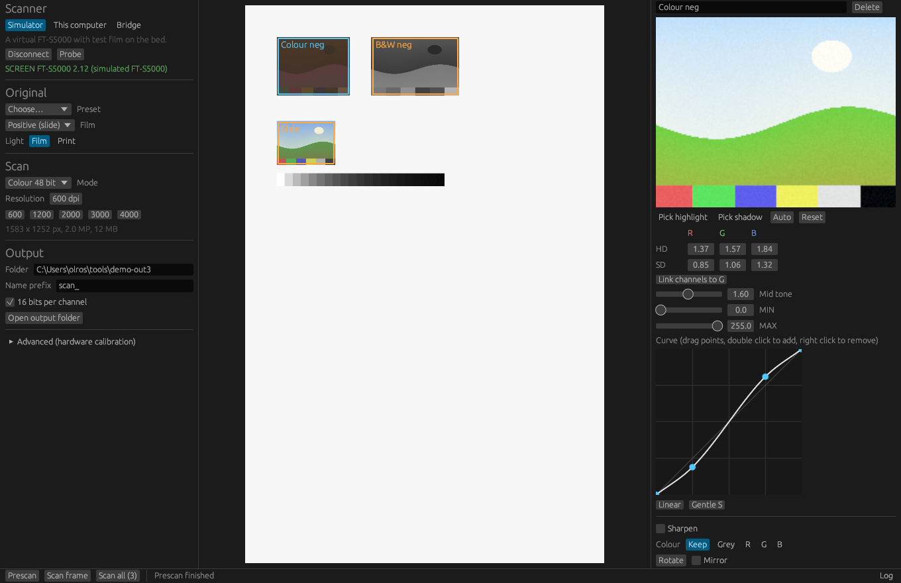

# Cezanne Scan

Modern scanning software for the **SCREEN Cezanne FT-S5000** film and flatbed scanner, for
current Windows, macOS and Linux.

The Cezanne was sold with ColorGeniusEX, which only runs on PowerPC Macs (Mac OS 9 or OS X
10.6 with Rosetta). Cezanne Scan replaces it. It was built by reverse engineering the
scanner's own firmware to learn its SCSI command set, so it talks to the scanner directly
with no SCREEN software installed.



> **Status:** the software is complete and fully tested against a simulated FT-S5000. Its
> scan commands match SCREEN's own driver byte for byte, but it has **not yet been run on a
> real scanner**. See [docs/STATUS.md](docs/STATUS.md) and the first test steps in
> [docs/hardware.md](docs/hardware.md).

## Features

* Whole bed prescan, then draw any number of frames with the mouse
* Per frame settings, so a whole roll of mixed film can be scanned in one batch
* The ColorGeniusEX way of working: highlight density (HD) and shadow density (SD) per
  channel, highlight and shadow droppers, MIN and MAX output levels
* Negatives by flipping HD and SD, exactly as Cezanne owners do it in ColorGeniusEX, with
  automatic orange mask removal for colour negatives
* Mid tone control, a curve editor, optional unsharp mask, single channel black and white,
  rotate and mirror
* 8 or 16 bit greyscale and 24 or 48 bit colour scanning
* 16 bit TIFF output with resolution tags and an embedded ICC profile
* Live densitometer readout under the mouse
* Presets, including the two black and white negative methods shared on the Large Format
  Photography forum
* `cezanne-bridge` shares the scanner over the network, which is how a Mac uses it
* `cezanne-cli` for scripted scans and diagnostics
* A built in simulated scanner, so everything can be tried without hardware
* Safety: commands that write firmware or factory settings into the scanner are blocked in
  every layer and can never be sent

## Install

Download the installer for your system from the
[Releases page](https://github.com/lupton1/cezanne-scan/releases).

### Windows 10 and 11

Run `cezanne-scan_<version>_x64-setup.exe`. It installs for the current user and needs no
administrator rights. It adds Cezanne Scan to the Start menu together with `cezanne-cli`
and `cezanne-bridge`.

Talking to a SCSI scanner directly needs administrator rights on Windows, so right click
Cezanne Scan and choose **Run as administrator** when scanning with a local SCSI card. The
simulator and the bridge client work without it.

### macOS 12 and later (Apple Silicon)

Open `Cezanne Scan_<version>_aarch64.dmg` and drag the app to Applications. The app is not
signed with an Apple Developer ID yet, so the first time right click it and choose
**Open**.

Current Macs have no way to drive a parallel SCSI scanner, so on a Mac Cezanne Scan
connects through `cezanne-bridge` running on a small Linux or Windows computer that has
the SCSI card. See [Using a Mac](#using-a-mac).

### Linux

Install the `.deb` (Debian, Ubuntu and similar) or run the `.AppImage`. The `.deb`
installs a udev rule that gives the `scanner` group access to the scanner. Add yourself to
that group once and log in again:

```bash
sudo usermod -aG scanner $USER
```

Linux has the best SCSI card support of the three systems and is the recommended host for
the scanner, either directly or as a bridge for a Mac.

## Connecting the scanner

The FT-S5000 is a SCSI-2 device. You need a SCSI host adapter, the right cable and correct
termination. [docs/hardware.md](docs/hardware.md) covers card choices for each system,
cabling, the SCSI ID and the first test on real hardware.

Power the scanner on before the computer so the SCSI bus sees it at boot. Then:

```bash
cezanne-cli list
```

## Scanning

1. Choose the connection (Simulator, This computer, or Bridge) and press **Connect**.
2. Pick the film type and press **Prescan**.
3. Drag a frame around each image on the bed. Click a frame to select it.
4. Adjust the selected frame on the right. Frames start with automatic HD and SD.
5. Set the resolution and output folder, then press **Scan all**.

Tips from Cezanne owners, built into the presets:

* **Negatives:** scan in positive mode and flip the densities. HD around 2.0 to 2.5 and
  SD 0 to 0.2. Use the highlight dropper on the brightest part of the picture and the
  shadow dropper on the film rebate. For colour negatives this also removes the orange
  mask.
* Keep MIN at 0 and MAX at 255, turn sharpening off and add a gentle S curve.
* **Black and white negatives:** scan in 48 bit colour and keep the cleanest channel
  (usually green). The Colour row on the right does this.
* Scan in 16 bit and do the final tone work in your photo editor.

## Using a Mac

On the computer with the SCSI card (Linux or Windows):

```bash
cezanne-bridge --listen 0.0.0.0:7810 --token choose-a-secret
```

On the Mac, choose **Bridge** in Cezanne Scan, enter the bridge computer's name or address
and the same token, and press **Connect**. Scans travel over the network. A wired network
is recommended for high resolution scans.

The bridge serves one client at a time and refuses commands that could change the
scanner's firmware or factory data, whatever the client sends.

## Command line

```bash
cezanne-cli list                         # find scanners
cezanne-cli probe                        # read only report, safe at any time
cezanne-cli scan --area 30,30,70,56 --dpi 2400 --film color-negative --auto -o frame1.tif
cezanne-cli scan --sim --dpi 300 -o test.tif    # try it with the simulator
cezanne-cli presets
```

Areas are in millimetres from the top left corner of the bed: `x,y,width,height`.

## Building

```bash
cargo build --release --workspace
cargo test --workspace
cargo install cargo-packager --locked
cargo packager -c Packager.toml --release --formats nsis   # or app,dmg or deb,appimage
```

Full details, including building on Windows without Visual Studio, are in
[docs/building.md](docs/building.md). GitHub Actions builds all three platforms, see
[.github/workflows/build.yml](.github/workflows/build.yml).

## Project layout

| Path | Contents |
|---|---|
| `crates/cezanne-core` | SCSI transports, FT-S5000 protocol, simulator, driver, image pipeline, TIFF and ICC output |
| `crates/cezanne-app` | the desktop app (egui) |
| `crates/cezanne-cli` | command line tool |
| `crates/cezanne-bridge` | network bridge |
| `docs/` | protocol, hardware, building, architecture and status notes |
| `packaging/` | icons and the Linux udev rule |
| `scripts/` | icon generator |

## How it was made

The FT-S5000 Maintainer tool (Java) and its native driver shim showed the shape of the
host software. The scanner firmware (`FT-S5000_V2.12.jfirm`) turned out to be an LHA archive
of Hitachi SH-2 code. Decompiling it gave the complete SCSI command dispatcher, the window
descriptor validation and the data formats. SCREEN's host driver ("FT-S5000 Driver" 2.1.3,
which still carries its debug function names) then confirmed exactly which bytes
ColorGeniusEX sends. The details are in [docs/protocol.md](docs/protocol.md) and
[docs/architecture.md](docs/architecture.md).

No SCREEN code, firmware, profiles or other files are included in this repository. The
analysis was done for interoperability with the owner's own scanner.

## Licence

MIT, see [LICENSE](LICENSE). This covers Cezanne Scan itself. SCREEN software, firmware and
profiles are not part of this project and are not covered by it.
