# Cezanne Scan user manual

Cezanne Scan is the modern replacement for ColorGeniusEX, the original software for the
SCREEN Cezanne FT-S5000 film and flatbed scanner. This manual covers setting it up and
using it from start to finish.

The pictures in this manual were taken with the built in simulated scanner, so the film
on the bed is a set of test images. Your own scanner looks the same, with your film on
the bed.

## Contents

1. [Two ways to use it](#1-two-ways-to-use-it)
2. [What you need](#2-what-you-need)
3. [Connecting the scanner](#3-connecting-the-scanner)
4. [Setting up the scan server on a Mac mini](#4-setting-up-the-scan-server-on-a-mac-mini)
5. [Opening the scan page](#5-opening-the-scan-page)
6. [The screen at a glance](#6-the-screen-at-a-glance)
7. [Scanning step by step](#7-scanning-step-by-step)
8. [Adjusting a frame](#8-adjusting-a-frame)
9. [Getting your files](#9-getting-your-files)
10. [Recipes for each kind of film](#10-recipes-for-each-kind-of-film)
11. [Presets](#11-presets)
12. [Colour and your photo editor](#12-colour-and-your-photo-editor)
13. [The desktop app](#13-the-desktop-app)
14. [Using a phone or tablet](#14-using-a-phone-or-tablet)
15. [Troubleshooting](#15-troubleshooting)
16. [Quick reference](#16-quick-reference)

---

## 1. Two ways to use it

**Scan server with a web page (recommended for a Mac mini).** The computer the scanner is
plugged into runs `cezanne-server` in the background. You open a web page on any computer,
tablet or phone on the same network and scan from there. The finished files download to
the computer you are using, as if the scanner were plugged into it.

**Desktop app.** Cezanne Scan also runs as a normal program on the computer the scanner is
plugged into, with exactly the same controls. Files are saved into a folder on that
computer. See [The desktop app](#13-the-desktop-app).

Both are in the same download, and they work the same way, so everything below applies to
both unless it says otherwise.

## 2. What you need

* The Cezanne FT-S5000 scanner.
* A computer next to it with a **SCSI card** that has a driver for its operating system.
  This is the hard part, see the [hardware guide](hardware.md) for which cards work:
  * **Linux** has the best support (LSI 53C1030 or Adaptec 29320 and 29160 cards).
  * **Windows 10 and 11** work with cards that have a 64 bit driver.
  * **macOS** needs a SCSI card with a macOS driver, usually an ATTO card in a Thunderbolt
    PCIe enclosure on an Intel Mac. If your Mac has no working card, a small Linux or
    Windows computer can hold the card and pass the scanner on to the Mac through
    `cezanne-bridge` (see [Bridge](#bridge)).
* A SCSI cable from the card to the scanner's 50 pin connector, and a terminator at the
  scanner end of the bus.
* Cezanne Scan, from the
  [Releases page](https://github.com/lupton1/cezanne-scan/releases):
  * Windows: `cezanne-scan_<version>_x64-setup.exe`
  * macOS: `Cezanne Scan_<version>_universal.dmg` (Intel and Apple Silicon)
  * Linux: the `.deb` or the `.AppImage`

No SCREEN software, drivers or old Mac are needed.

### Installing

**Windows.** Run the setup file. It installs for your user without administrator rights
and adds Cezanne Scan to the Start menu. `cezanne-server.exe`, `cezanne-cli.exe` and
`cezanne-bridge.exe` are installed next to it.

**macOS.** Open the `.dmg` and drag Cezanne Scan to Applications. The app is not signed by
an Apple developer account, so macOS stops it the first time:

* macOS 15 Sequoia and later: open the app once and close the warning. Then open System
  Settings, Privacy and Security, scroll down to the message about Cezanne Scan, click
  **Open Anyway** and enter your password.
* macOS 14 and earlier: right click the app in Applications and choose **Open**.
* Or in Terminal: `xattr -dr com.apple.quarantine "/Applications/Cezanne Scan.app"`

**Linux.** Install the `.deb`, then add yourself to the `scanner` group once and log out
and in again:

```bash
sudo usermod -aG scanner $USER
```

## 3. Connecting the scanner

1. With everything switched off, connect the SCSI cable from the card to the scanner and
   make sure the scanner end is terminated.
2. Give the scanner a SCSI ID that nothing else on the bus uses. ID 0 is what the
   original setup used. The card itself is usually ID 7.
3. **Switch the scanner on first**, wait until it has finished starting up, then start
   the computer. The computer only looks for SCSI devices when it starts.
4. Check that the computer can see it. In Terminal or a command prompt:

   ```bash
   cezanne-cli list
   ```

   It should list `SCREEN FT-S5000`. On Windows run the command prompt as administrator.

The first scan after switching the scanner on takes a few minutes longer while the lamp
warms up. Cezanne Scan waits for it on its own.

## 4. Setting up the scan server on a Mac mini

This makes the Mac mini a scan server that starts by itself whenever the Mac starts, with
nobody logged in.

1. Install Cezanne Scan into Applications (see [Installing](#installing)).
2. Get the Cezanne Scan source folder onto the Mac (download it from GitHub with the green
   **Code** button, then **Download ZIP**, and unzip it). It contains the set up script.
3. Open Terminal, go into that folder and run the script with an access token of your
   choice. The token is a password for the scan page, so anyone else on your network
   cannot use the scanner:

   ```bash
   cd ~/Downloads/cezanne-scan-main
   sudo bash packaging/macos/install-server.sh --token choose-a-secret
   ```

   Enter your Mac password when asked. The script:
   * installs the server so it starts when the Mac starts and restarts if it ever stops
   * lets it through the macOS firewall if the firewall is on
   * warns you if the Mac is set to sleep
   * prints the address of the scan page, for example `http://mac-mini.local:7820`

4. **Keep the Mac awake.** A sleeping Mac stops the scan page. In System Settings, Energy,
   turn on **Prevent automatic sleeping**, or run `sudo pmset -a sleep 0`.

Scans are kept on the Mac in `Pictures/Cezanne Scans` in your home folder until you remove
them from the scan page. The server's log is `/Library/Logs/cezanne-server.log`.

Options for the script:

| Option | What it does |
|---|---|
| `--token SECRET` | the password for the scan page (recommended) |
| `--port 7820` | the port of the scan page |
| `--connect auto` | which scanner to open at start: `auto` (the first one found), `sim` (the simulator), a device address, or `bridge:HOST` |
| `--bridge-token SECRET` | the bridge's token, with `--connect bridge:HOST` |
| `--output-dir FOLDER` | where scans are kept on the Mac |
| `--uninstall` | removes the server again (your scans are kept) |

Run the script again after installing a new version of Cezanne Scan.

**Linux and Windows** can be scan servers too. See [server.md](server.md#linux).

## 5. Opening the scan page

On any computer, tablet or phone on the same network, open a web browser and go to the
address the script printed, for example:

```
http://mac-mini.local:7820
```

If the name does not work, use the Mac's IP address instead (System Settings, Network,
then the connection in use), for example `http://192.168.0.40:7820`.

The first time, the page asks for the access token. Enter the one you chose and press
**Continue**. The browser remembers it.

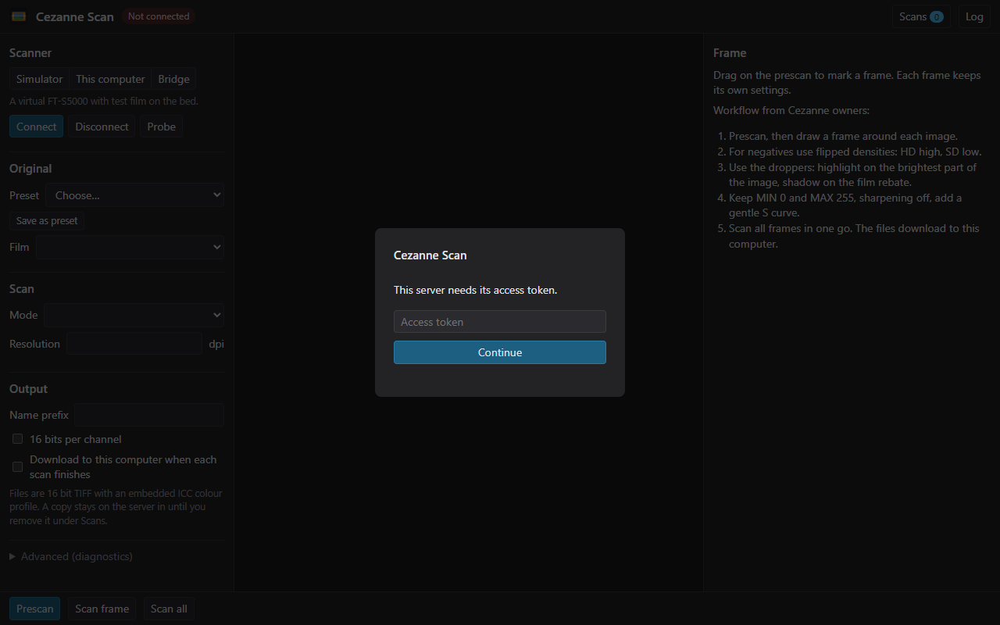

## 6. The screen at a glance

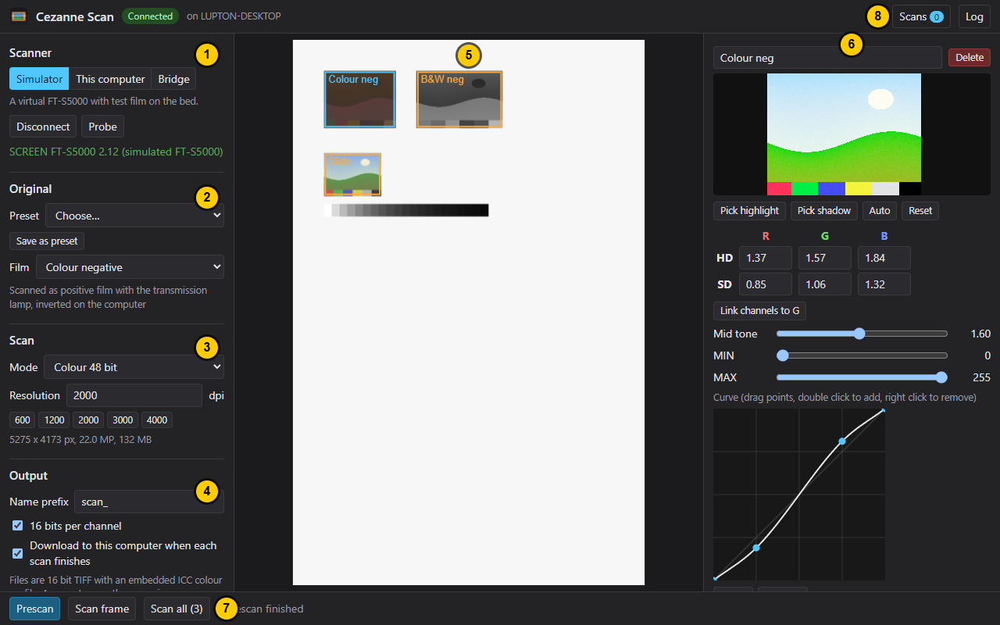

1. **Scanner.** How the scanner is connected, and the Connect, Disconnect and Probe buttons.
2. **Original.** Presets and the type of film on the bed.
3. **Scan.** Colour mode and resolution, with the size of the selected frame.
4. **Output.** File name, bit depth and automatic download.
5. **The bed.** The prescan of the whole scanner bed with your frames drawn on it.
6. **The frame panel.** All settings for the selected frame, with a live preview.
7. **Prescan and Scan buttons**, with progress and the latest message next to them.
8. **Scans and Log.** Your finished files, and the full message log.

Below the Output section is **Advanced (diagnostics)**. Leave it alone unless you are
asked to change something there. It holds the prescan resolution (75 dpi) and two
settings that only matter for testing.

## 7. Scanning step by step

### Step 1: Connect

Under **Scanner** choose how the scanner is connected and press **Connect**. On a Mac mini
set up with the script, it is already connected when you open the page.

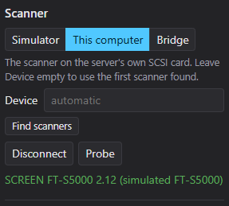

* **This computer** is the scanner on the server's own SCSI card. Leave Device empty to
  use the first scanner found, or press **Find scanners** to list them.
* **Bridge** is a scanner on another computer running `cezanne-bridge`. Enter that
  computer's name or address and its token.
* **Simulator** is a pretend scanner with test film, for trying things out.

When it works, the badge at the top turns green and says **Connected**, and the scanner's
name appears in green under the buttons.

### Step 2: Choose the film

Under **Original** pick the **Film**:

| Film | Use it for |
|---|---|
| Positive (slide) | slides and other positive transparencies |
| Colour negative | colour negative film, the orange mask is removed for you |
| Black and white negative | black and white negative film |
| Print (reflective) | photographs and other prints on paper |

Negatives are scanned as positive film and turned into positives on the computer. This is
the method Cezanne owners use with ColorGeniusEX. The grey note under the list tells you
how the scanner will treat the film.

### Step 3: Prescan

Press **Prescan**. The scanner makes a quick, low resolution scan of the whole bed. The
progress bar at the bottom shows how far it is.

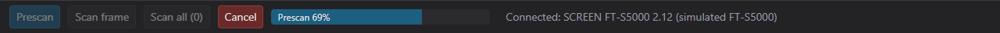

When it finishes, the bed appears in the middle of the screen.

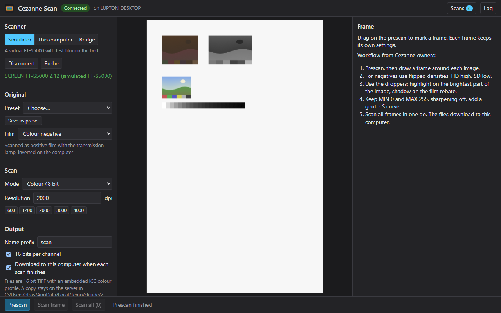

Move the pointer over the bed to read densities. The bottom bar shows the position in
millimetres and the density of each colour channel under the pointer, like the
densitometer in ColorGeniusEX.

### Step 4: Draw a frame around each picture

Press and drag on the bed around a picture. A yellow box follows the pointer. Let go and
it becomes a frame.

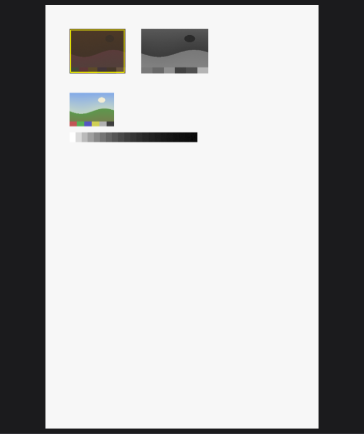

Draw as many frames as you like. Each frame has its own name and settings, so a mix of
film can be scanned in one go. Click a frame to select it (it turns blue). Press
**Delete** on the keyboard, or the **Delete** button in the frame panel, to remove the
selected frame.

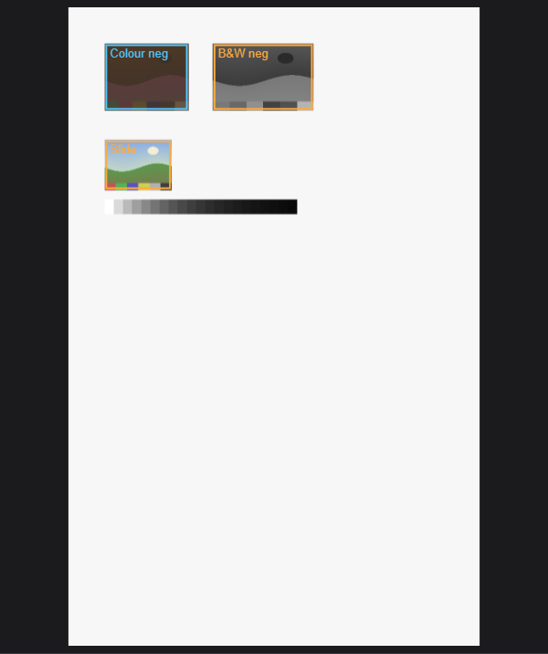

A new frame starts with the settings of the frame that was selected, which saves work on a
roll of the same film. Each new frame gets automatic levels the first time it is shown.

Your frames and settings are saved in your browser, so they are still there if you
reload the page or come back later.

### Step 5: Adjust each frame

Select a frame and adjust it in the frame panel on the right. The preview updates as you
change things. See [Adjusting a frame](#8-adjusting-a-frame) for every control.

### Step 6: Set the resolution and output

Under **Scan**:

* **Mode**: Colour 48 bit is the best choice for nearly everything, including black and
  white film. Colour 24 bit, Grey 16 bit and Grey 8 bit are there if you need them.
* **Resolution** in dots per inch. The buttons below set common values. Under them is the
  size of the selected frame at that resolution, in pixels, megapixels and megabytes. If
  the frame is too wide for the scanner at that resolution it says so in red.

Under **Output**:

* **Name prefix**: files are named with this prefix and a number, for example
  `scan_0001.tif`.
* **16 bits per channel**: leave this on for the best quality.
* **Download to this computer when each scan finishes**: leave this on to get each file
  straight away.

### Step 7: Scan

Press **Scan all** to scan every frame, or **Scan frame** for the selected one only. The
bottom bar shows which frame is being scanned and how far it is. **Cancel** stops after
the current read.

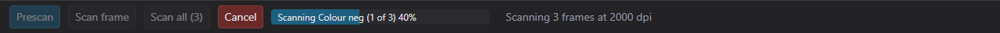

Only one scan can run at a time. If someone else opens the page while you are scanning,
they see your progress and cannot start a scan of their own until it finishes.

## 8. Adjusting a frame

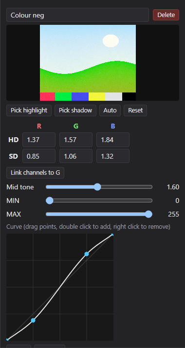

**Name.** The box at the top. It is shown on the bed and in the list of scans.

**Preview.** The frame as it will look, with all its settings applied.

**HD and SD** (highlight density and shadow density) are the main controls, exactly as in
ColorGeniusEX. Each colour channel (R, G, B) has its own pair.

* HD is the density that becomes white. SD is the density that becomes black.
* For slides and prints HD is low and SD is high (for example 0.15 and 2.8).
* For negatives they are flipped: HD high and SD low (for example 2.2 and 0.15). That is
  what turns a negative into a positive.
* Different values per channel correct colour. On colour negatives this is what removes
  the orange mask.
* **Link channels to G** copies the green values to red and blue, for neutral black and
  white work.

**Pick highlight and Pick shadow** are droppers. Press one, then click on the preview:

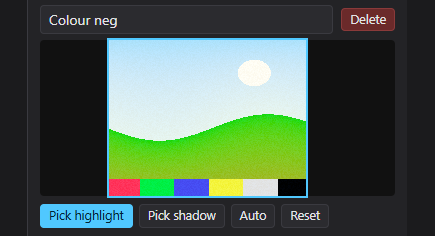

* Pick highlight: click the brightest part of the picture that should still show detail.
* Pick shadow: click the darkest part. On negatives the film rebate (the clear edge
  between frames) is a good shadow point.

**Auto** sets HD and SD from the frame itself, per channel. **Reset** puts every setting
back to the starting values for that film type.

**Mid tone** brightens (above 1) or darkens (below 1) the middle tones without moving
black and white.

**MIN and MAX** are the output levels. Owners recommend leaving them at 0 and 255.

**Curve.** A tone curve like the one in a photo editor.

* Drag a point to move it.
* Double click on the curve to add a point.
* Right click a point to remove it.
* **Linear** starts again with a straight line. **Gentle S** gives a small contrast boost.

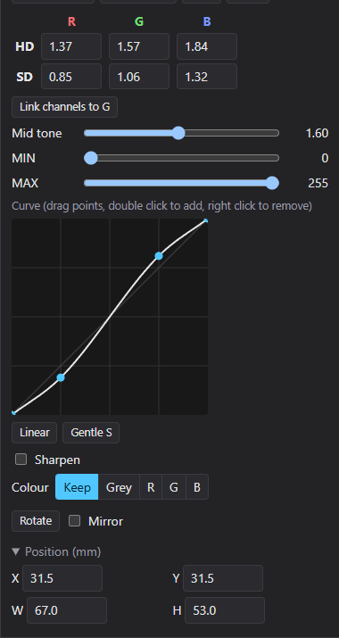

**Sharpen.** Off by default, which is what owners recommend for archive scans. Turn it on
for an unsharp mask with an amount and a radius.

**Colour.**

* **Keep**: a normal colour scan.
* **Grey**: turns the scan into black and white using all three channels.
* **R, G or B**: keeps only one channel as black and white. For black and white negatives
  the green channel is often the cleanest.

**Rotate** turns the picture a quarter turn clockwise each time it is pressed. **Mirror**
flips it left to right, for film that was placed upside down.

**Position (mm).** Opens to show the exact position and size of the frame on the bed, so
it can be adjusted to the tenth of a millimetre.

## 9. Getting your files

With **Download to this computer when each scan finishes** ticked, each file downloads to
your computer as soon as it is ready, into the browser's normal download folder. The first
time a scan of several frames finishes, the browser may ask whether the page may download
several files. Allow it.

To choose the folder for each file instead, turn on **Ask where to save each file** in
your browser's download settings (Chrome and Edge: Settings, Downloads. Safari: Settings,
General, File download location, Ask for each download).

Every scan is also kept on the server until you remove it. Press **Scans** at the top right
to see them:

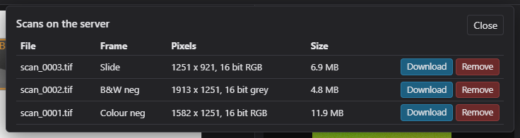

* **Download** gets the file (again). Files you have downloaded show **Download again**.
* **Remove** deletes the copy on the server. If you have not downloaded it yet, the page
  asks first.

Scans stay in this list after the server or the Mac is restarted, so nothing is lost if
the power goes off before you download.

The files are uncompressed TIFF, 16 bits per channel (or 8 if you turned that off), with
the scan resolution stored in the file and the scanner's colour profile embedded.

## 10. Recipes for each kind of film

These are the methods Cezanne owners use with ColorGeniusEX, and they work the same here.

**Colour negative**

1. Film: Colour negative. Mode: Colour 48 bit, 16 bits per channel.
2. Prescan and draw the frames. Auto levels are applied, which removes the orange mask.
3. If needed, use Pick highlight on the brightest part of the picture and Pick shadow on
   the film rebate.
4. Keep MIN 0 and MAX 255, sharpening off, and add a Gentle S curve.

**Black and white negative, flipped densities**

1. Film: Black and white negative, or the preset **B&W negative (flipped HD/SD)**.
2. HD around 2.0 to 2.5, SD 0 to 0.2. Press **Link channels to G** to keep it neutral.
3. Keep MIN 0 and MAX 255, sharpening off, a slight S curve.

**Black and white negative, best channel**

1. Use the preset **B&W negative (best channel)**. It scans in colour and keeps only the
   green channel.
2. Try R and B under Colour as well, and keep whichever looks cleanest.

**Slides**

1. Film: Positive (slide). Usually Auto gives a good start.
2. Use the droppers if the colours need correcting.

**Prints**

1. Film: Print (reflective). The scanner uses its reflective lamp.
2. 600 dpi is plenty for most prints.

In every case, scan in 16 bit and do the final fine tuning in your photo editor.

## 11. Presets

The **Preset** list under Original holds ready made settings:

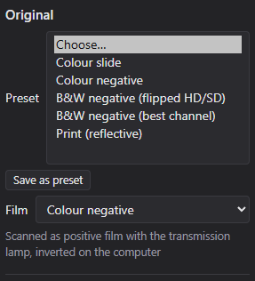

| Preset | What it sets |
|---|---|
| Colour slide | positive film, automatic levels |
| Colour negative | colour negative, automatic levels, gentle S curve |
| B&W negative (flipped HD/SD) | HD 2.2, SD 0.1, slight S curve, green channel |
| B&W negative (best channel) | automatic levels, green channel |
| Print (reflective) | print, 600 dpi |

Choosing a preset sets the film, mode and resolution, and applies its settings to the
selected frame.

**Save as preset** saves the selected frame's settings, with the current mode and
resolution, under a name you choose. Saved presets are stored on the server, so everyone
using the scan page sees them, and they show **(saved)** after their name.

## 12. Colour and your photo editor

Cezanne Scan handles colour the same way ColorGeniusEX did. The scan stays in the
scanner's own colour space, which SCREEN describes with its **5000stdRGB** profile, and
every file has that profile embedded. Your ColorGeniusEX settings used 5000stdRGB for both
input and output, so files from Cezanne Scan match what you got before.

This colour space is wider than the usual sRGB. To see the colours correctly, open the
files in a program that reads embedded profiles, such as Photoshop, Lightroom, Affinity
Photo, GIMP or macOS Preview.

In **Photoshop**:

* When it asks, choose **Use the embedded profile**.
* To work in your usual space, use Edit, Convert to Profile and pick Adobe RGB, ProPhoto RGB
  or sRGB. Do not use Assign Profile, which changes the colours.

The previews in Cezanne Scan are converted for your screen, so they look the way the file
will look in a colour managed editor.

## 13. The desktop app

The desktop app has the same controls as the scan page, in one window, and talks to the
scanner directly.

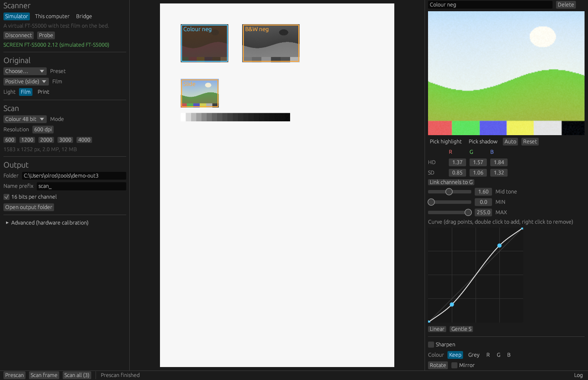

The differences:

* Files are saved straight into the **Folder** under Output (by default `Pictures/Cezanne
  Scans`). **Open output folder** shows it.
* On Windows, right click Cezanne Scan and choose **Run as administrator** to use a scanner
  on a SCSI card. The simulator and the bridge work without it.
* **Probe** and the **Log** button work the same as on the scan page.

### Bridge

A bridge lets a computer without a SCSI card use the scanner on one that has a card. On
the computer with the card:

```bash
cezanne-bridge --listen 0.0.0.0:7810 --token choose-a-secret
```

Then in the app or on the scan page choose **Bridge**, enter that computer's name or
address and the same token, and press **Connect**. A wired network is best for high
resolution scans.

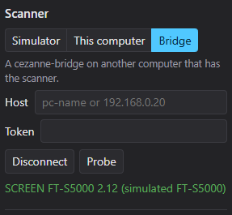

A scan server can use a bridge too: install the server with
`--connect bridge:HOST --bridge-token SECRET`.

## 14. Using a phone or tablet

The scan page works on phones and tablets. The parts are stacked: settings first, then the
bed, then the frame panel. Drag with a finger to draw frames.

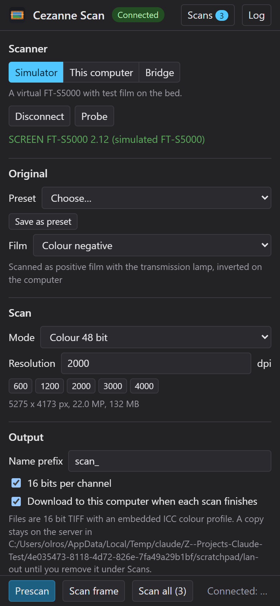

Removing a curve point needs a right click, so on a touch screen use **Linear** to start
the curve again.

## 15. Troubleshooting

**The scan page does not open.**

* Check the computer or phone is on the same network as the Mac.
* Try the IP address instead of the `.local` name.
* Check the Mac is awake and the server is running: in Terminal on the Mac,
  `sudo launchctl print system/com.lupton1.cezanne-server` should say `state = running`.
* Look at the end of `/Library/Logs/cezanne-server.log` on the Mac.

**It asks for the token again, or says the token is wrong.** Enter the token you chose
when installing. To change it, run the install script again with a new `--token`.

**Not connected, or "Connection failed".**

* The scanner must be switched on before the computer. Switch everything off, then on in
  that order.
* Press **Find scanners** (This computer). If nothing is found, the computer cannot see the
  scanner: check the card's driver, the cable, the termination and the SCSI ID (see the
  [hardware guide](hardware.md)).
* On Windows the server or app must run as administrator.
* Press **Connect** again. The server does not keep retrying on its own.

**The scanner is busy.** Someone else is scanning. Wait for their progress bar to finish.

**"Too large" or "Too wide for the scanner".** Lower the resolution or make the frame
smaller. The scanner can make at most 12,000 pixels per line.

**The first scan takes a long time.** The lamp warms up for up to a few minutes after the
scanner is switched on or after changing between film and prints. This is normal.

**Nothing downloaded.** Allow the page to download several files when the browser asks, or
press **Scans** and download them from the list.

**Lost contact with the server.** The Mac went to sleep, restarted or left the network.
Reload the page when it is back. Your frames and settings are still there, and finished
scans are listed under Scans.

**The colours look dull in another program.** That program is ignoring the embedded
profile. Use one that reads it, see [Colour and your photo editor](#12-colour-and-your-photo-editor).

**Something else.** Press **Probe** with the scanner connected, then **Log**, and keep what
it shows. It is a read only report of the scanner's state and the most useful thing to
have when asking for help.

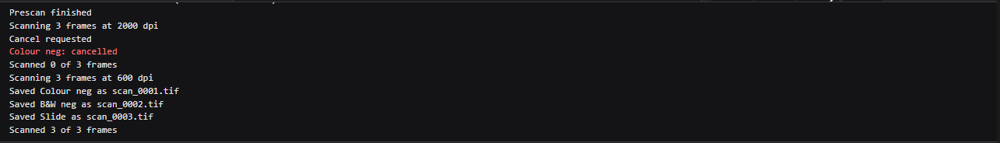

## 16. Quick reference

| Task | How |
|---|---|
| Open the scan page | `http://<mac-name>.local:7820` |
| Connect | Scanner, choose the connection, **Connect** |
| See the bed | **Prescan** |
| Make a frame | drag on the bed |
| Select a frame | click it |
| Delete a frame | select it, then **Delete** |
| Set white and black | **Pick highlight** and **Pick shadow**, then click the preview |
| Automatic levels | **Auto** |
| Start a frame again | **Reset** |
| Add a curve point | double click the curve |
| Remove a curve point | right click it |
| Scan everything | **Scan all** |
| Stop a scan | **Cancel** |
| Find finished files | **Scans** |
| See all messages | **Log** |
| Scanner report for help | **Probe**, then **Log** |

Safety: Cezanne Scan never sends the commands that rewrite the scanner's firmware or
factory calibration, whatever is pressed.
